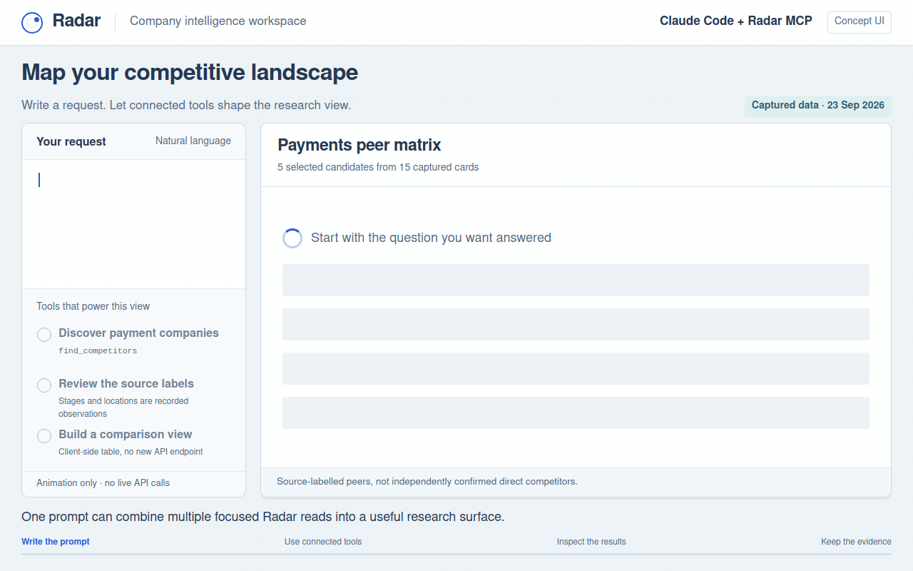
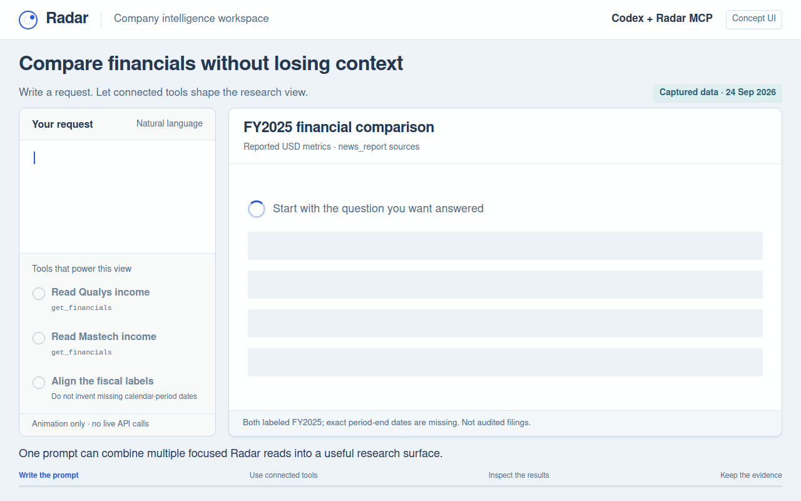
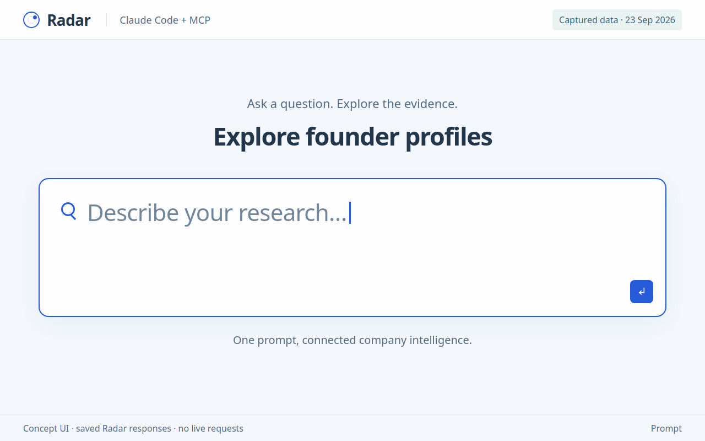
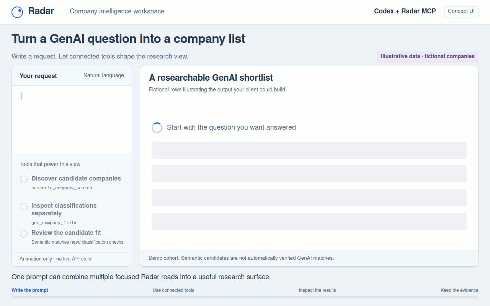
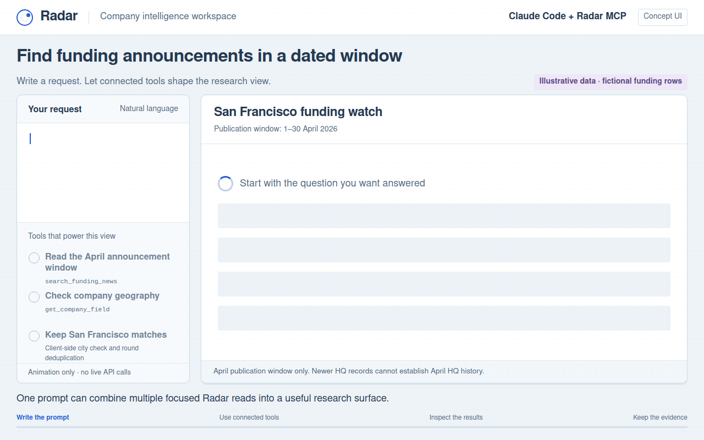
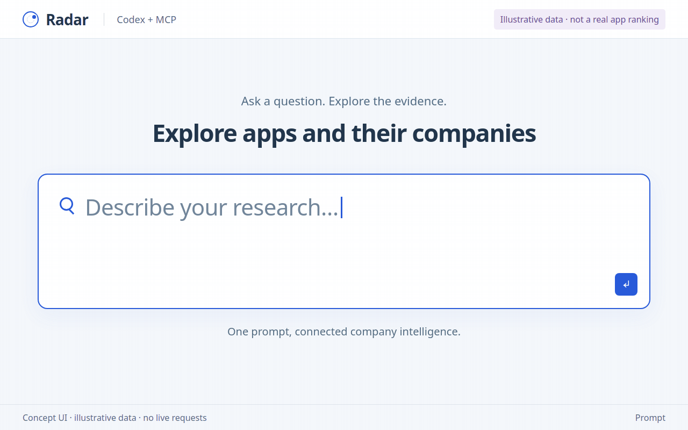
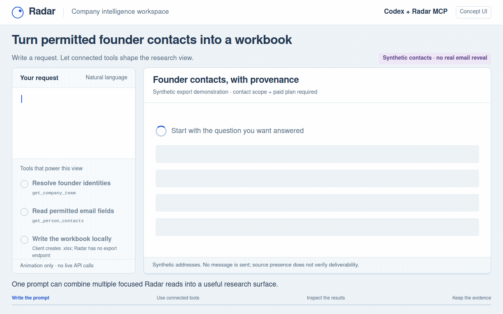

# Radar API + MCP — B2B company data, financial data and news

Retrieve B2B company data, company intelligence, financial statements, financial
news, startup funding data, funding news, investors, individual apps, jobs,
internships and company growth/sales-prospect signals from
**one interface with 53 data capabilities**.
The same validated operations are available over REST and MCP.

**Company data depth:** [see real Razorpay, Stripe and Swiggy records](docs/COMPANY_DATA_DEPTH.md)
with sectors, primary/other feeds, founders, technology stacks, website performance,
traffic, apps, products, hiring, patents and social data. Start with compact identity
and available fields, then request one of 18 fields separately.
[Filters and listing columns](docs/FILTERS_AND_LISTINGS.md) and
[email/phone retrieval](docs/CONTACTS.md) have separate JSON POST workflows.

**Private preview — owner approval is required before public release.** No public
API host, active checkout or production API-key integration is claimed. Installing
this package does not deploy a service or change Radar.

Optional account mode adds a developer console for API-key issuance and revocation,
account-wide usage limits, prepaid credit metering, company following and payment
verification. It follows Radar's existing subscription catalog. The per-use rate
is unset and checkout stays disabled until configured. Start with
[API keys](docs/guides/api-keys-authentication.md),
[pricing and pay-per-use](docs/guides/pricing-pay-per-use.md), or the
[complete documentation hub](docs/README.md).

Start with [real endpoint request/response examples](docs/reference/README.md):
all **53 data operations and 16 account/discovery operations**, plus a captured
MCP session and browser-route responses. Each reference includes parameter tables,
REST/MCP calls, field explanations and downloadable JSON. The 19 workflow guides
also include worked outputs inline. [Observed data quality](docs/DATA_QUALITY.md)
explains identity mismatches, incomplete searches and unavailable News connections.

Financial responses distinguish filing-derived figures from news-reported earnings,
retain fiscal periods and currencies, and disclose when the linked Radar account
exposes only part of the archive. Company briefs combine multiple sections and
mark individual failures instead of treating unavailable data as zero.

**Tested business questions:** [50 executed requests and full outputs](docs/scenarios/README.md),
[baseline findings and repairs](docs/SCENARIO_AUDIT.md), and
[all 43 company filters analysed](docs/FILTER_AUDIT.md).
Start with [exact financial screening](docs/guides/financial-filters-data-api.md),
[company teams and professional data](docs/guides/teams-people-data-api.md), or
[technology stacks and website traffic](docs/guides/technology-traffic-data-api.md).

The [endpoint output audit](docs/OUTPUT_DEPTH_AUDIT.md) explains which endpoint owns
each kind of detail, the richer financial/company/app outputs, and current live
coverage failures. [Complete company examples](docs/COMPANY_DATA_DEPTH.md) include
traffic devices and ranks, customer-review samples, lifecycle context and LinkedIn observations.

## See the API in a research UI

[Seven animated Claude Code / Codex workflow concepts](docs/ANIMATED_USE_CASES.md)
show competitor analysis, financial comparisons, founder LinkedIn profiles, GenAI
startup discovery, San Francisco funding in April 2026, dating-app rankings with
company legal details, and founder-email exports to Excel. Each GIF labels saved
Radar data or illustrative rows; these are client-built UI concepts, not recordings
of official client interfaces or claims of live service availability.

Each animation opens with a large typed prompt that slides away, then shows a
full-screen chart and detailed results. Click any animation to open it at full size.

<table>
  <tr>
    <td width="50%" valign="top">
      <h3>Competitor analysis</h3>
      <a href="docs/demos/media/competitor-analysis.gif"></a>
      <p>Compare market peers, locations and funding stages. Saved Radar data.</p>
    </td>
    <td width="50%" valign="top">
      <h3>Financial comparison</h3>
      <a href="docs/demos/media/financial-comparison.gif"></a>
      <p>Compare revenue, net income and EBITDA with source labels. Saved Radar data.</p>
    </td>
  </tr>
  <tr>
    <td width="50%" valign="top">
      <h3>Founders &amp; LinkedIn</h3>
      <a href="docs/demos/media/founder-linkedin.gif"></a>
      <p>Explore founder profiles, LinkedIn links, education and skills. Saved Radar data.</p>
    </td>
    <td width="50%" valign="top">
      <h3>GenAI startup discovery</h3>
      <a href="docs/demos/media/genai-startups.gif"></a>
      <p>Turn a research prompt into a filtered startup shortlist. Illustrative data.</p>
    </td>
  </tr>
  <tr>
    <td width="50%" valign="top">
      <h3>San Francisco funding · April 2026</h3>
      <a href="docs/demos/media/sf-funding-april-2026.gif"></a>
      <p>Combine dated funding news with company geography. Illustrative data.</p>
    </td>
    <td width="50%" valign="top">
      <h3>Top 10 dating apps &amp; legal details</h3>
      <a href="docs/demos/media/dating-apps-legal.gif"></a>
      <p>Rank apps by stored installs and inspect company legal records. Illustrative data.</p>
    </td>
  </tr>
  <tr>
    <td width="50%" valign="top">
      <h3>Founder emails to Excel</h3>
      <a href="docs/demos/media/founder-email-excel.gif"></a>
      <p>Prepare a spreadsheet with contact provenance and missing rows. Synthetic contacts; illustrated export.</p>
    </td>
    <td width="50%" valign="top">
      <h3>Explore every workflow</h3>
      <p><a href="docs/ANIMATED_USE_CASES.md">Read the prompts, requests and data notes</a>.</p>
      <p><a href="docs/demos/README.md">Run the local interactive gallery</a> for workflow selection, pause and replay.</p>
    </td>
  </tr>
</table>

[Browse all seven GIFs](docs/ANIMATED_USE_CASES.md) ·
[Open the local interactive gallery](docs/demos/index.html)

**Contact and social workflows:** [founder details and contacts](docs/guides/founder-contact-data-api.md),
[company/professional emails](docs/guides/company-email-phone-api.md),
[LinkedIn and social references](docs/guides/linkedin-social-data-api.md),
[24 request recipes](docs/CONTACT_REQUEST_RECIPES.md) and the
[research findings index](docs/research/README.md).

**Expanded data workflows:** [mobile apps and seven detail fields](docs/guides/apps-data-api.md),
[companies offering internships](docs/guides/internships-companies-api.md), and
[company growth potential and B2B prospects](docs/guides/potential-company-data-api.md).
Real examples include four exact-host Swiggy apps, dated install growth and internship
requirements/stipends. See the [Radar coverage map](docs/RADAR_FEATURE_COVERAGE.md).

## Quick start

The server runs on Linux/macOS with POSIX file permissions; HTTP clients can run
on other platforms.

### One-line local setup

Requires Bash, curl and Python 3.11+ with `venv` support. During the private preview,
export `GH_TOKEN` with **Contents: read** access to this repository, then run:

```bash
bash -o pipefail -c 'curl -fsSL --config <(printf "header = \"Authorization: Bearer %s\"\n" "${GH_TOKEN:?Export GH_TOKEN first}") https://raw.githubusercontent.com/fliarbi/radar-api-mcp/main/scripts/install.sh | bash'
```

This installs into `~/.local/share/radar-api-mcp`, creates a local API key without
printing it, and writes REST/MCP launchers plus `mcp.json`. Existing installations
are preserved. Start the local server when ready:

```bash
~/.local/share/radar-api-mcp/bin/radar-api --port 8810
```

Data access still requires the operator's Radar upstream. See
[installation, private access, MCP setup and troubleshooting](docs/INSTALL.md)
for details. The installer does not start services automatically.

### Manual setup from a checkout

```bash
python3 -m venv .venv
. .venv/bin/activate
python -m pip install -e '.[dev]'
```

Set `RADAR_UPSTREAM_URL` to the Radar service supplied by your operator. Optionally
set `RADAR_NEWS_URL` and `RADAR_BUSINESS_NEWS_URL` to the separately operated News
API services. `.env.example` lists the settings; the application reads environment
variables, not `.env` files automatically.

For detailed company profiles, configure the operator-only `RADAR_PROFILE_MONGO_URI`
connection described in [operator setup](docs/OPERATIONS.md). The gateway performs
fixed, bounded reads of the existing grouped company records. With no connection,
`get_company` explicitly reports `profile_depth=card`; it does not pretend the
shortlist card represents all available company data.

Create a preview key locally:

```bash
radar-create-key --name local-preview
export RADAR_API_KEY="$(cat secrets/client-key.txt)"
radar-api --port 8810
```

The server binds to `127.0.0.1`. The key store and client key are owner-only files
under the ignored `secrets/` directory. Each preview key can link to its own Radar
session and News API key; see [operator setup](docs/OPERATIONS.md). A key without a
linked Radar session receives Radar's anonymous coverage. This does not unlock
paid features. News requires a linked News API key and a configured News service.

```bash
curl -sS http://127.0.0.1:8810/v1/companies/financials \
  -H "Authorization: Bearer $RADAR_API_KEY" \
  -H 'Content-Type: application/json' \
  -d '{"domain":"microsoft.com","statement":"income","period_type":"annual"}'

curl -sS http://127.0.0.1:8810/v1/companies/brief \
  -H "Authorization: Bearer $RADAR_API_KEY" \
  -H 'Content-Type: application/json' \
  -d '{"domain":"microsoft.com","include_news":true}'
```

## Connect an MCP client

For a local stdio client, use this server configuration with absolute paths and
your issued preview key in the client's secret/environment configuration:

```json
{
  "mcpServers": {
    "radar": {
      "command": "/absolute/path/radar-api-mcp/.venv/bin/radar-mcp",
      "env": {
        "RADAR_KEYS_FILE": "/absolute/path/radar-api-mcp/secrets/keys.json",
        "RADAR_UPSTREAM_URL": "http://127.0.0.1:5100",
        "RADAR_API_KEY": "YOUR_ISSUED_PREVIEW_KEY"
      }
    }
  }
}
```

The HTTP server also serves **Streamable HTTP MCP at `/mcp`**, protected by the
same `Authorization: Bearer ...` or `X-API-Key` header as REST. Use a client that
supports custom authentication headers. OAuth discovery and public connector
onboarding are not part of this private preview.

Try: “Find enterprise AI companies in India, compare two companies' financials,
and show the news and funding behind their recent activity.”

## What you can retrieve

| Area | Capabilities |
|---|---|
| Companies | Filtered and natural-language search, profiles, competitors, intelligence, comparison |
| Financials | Income, balance-sheet and cash-flow metrics, annual/quarterly filters, source labels |
| Activity | Company events, funding rounds, legal details, reputation, hiring, digital presence |
| Investors and markets | Investor search/directory/pages, market pulse, location intelligence, industry discovery |
| People and jobs | Professional search, job filters/suggestions, salaries, experience, employment types, sources and hiring companies |
| Internships | Skill/location/stipend/date search, employer lists, listing detail and deadline qualifications |
| Mobile apps | App/category search, exact-host company apps, compact profiles, ratings, monetization, growth and install history |
| Company potential | Six explainable growth, investment and B2B prospecting screens with measured evidence |
| News | General/business headlines, full articles, volume, sentiment, overview, business events, funding coverage |
| Combined research | Company brief with section-level errors, access limits and dates |

The 53 MCP tools are retrieval operations. Optional account-management HTTP routes
are separate. Email/phone retrieval requires explicit contact scope and a paid
linked Radar account. CRM sending, applications and resume handling are not included. Published investor pages
now expose measured summaries and separate paginated fields from a verified Atlas release.
The optional investor data connection is required for detail; source publication gates remain authoritative.

Read the [user guide](docs/USER_GUIDE.md), [capability map](docs/CAPABILITIES.md),
[operator guide](docs/OPERATIONS.md) and [verification record](docs/VERIFICATION.md).
Authenticated discovery is at `/v1/capabilities`; OpenAPI is at `/v1/openapi.json`.

## Guides by data and use case

| Build with Radar | Documentation |
|---|---|
| B2B business data and company lookup | [B2B data API](docs/guides/b2b-data-api.md), [company data API](docs/guides/company-data-api.md) |
| Company discovery and CRM research | [Company search](docs/guides/company-search-api.md), [company enrichment](docs/guides/company-enrichment-api.md) |
| Company financial research | [Financial data](docs/guides/financial-data-api.md), [financial statements](docs/guides/company-financial-statements-api.md) |
| Earnings and investment announcements | [Financial news](docs/guides/financial-news-api.md), [funding news](docs/guides/funding-news-api.md) |
| Startup and venture capital research | [Funding rounds](docs/guides/startup-funding-data-api.md), [investor data](docs/guides/investor-data-api.md) |
| Business activity and peer analysis | [Company monitoring](docs/guides/company-monitoring-api.md), [competitor intelligence](docs/guides/competitor-intelligence-api.md), [hiring signals](docs/guides/hiring-signals-jobs-api.md) |
| App and mobile intelligence | [Individual apps, ratings and install growth](docs/guides/apps-data-api.md) |
| Early-career hiring | [Internship listings and employer lists](docs/guides/internships-companies-api.md) |
| Growth research and sales prospects | [Company potential data](docs/guides/potential-company-data-api.md) |
| AI-agent research tools | [Company intelligence MCP server](docs/guides/company-intelligence-mcp-server.md) |

These guides include request examples, interpretation details, source coverage and
common integration questions. [Search research](docs/SEARCH_RESEARCH.md) records
the terminology research and the distinction between private documentation and
future public discoverability.

## Development

```bash
pytest
ruff check radar_api tests scripts
python -m build
```

Tests use synthetic data and include real MCP HTTP and stdio protocol sessions.
Live probes are separate, opt-in and never run in CI. The implementation uses the
[official MCP Python SDK v1](https://py.sdk.modelcontextprotocol.io/v1/), pinned
below v2 to match the tested FastMCP API.

Copyright Fliar Business Intelligence. Proprietary; all rights reserved.

Investor depth: [portfolio, cohorts, co-investors and sourced news](docs/INVESTOR_DATA_DEPTH.md).
The [response depth audit](docs/DATA_DEPTH_AUDIT.md) checks every endpoint example for silently omitted business fields.
